<div align="center">

[简体中文](README.md) · **English**



# Snug

**A native-grade Mac experience, right on your phone**

Built for UU Remote<br>Native portrait display · Native gestures · App Library · Fits every phone

[](https://github.com/zephyr4123/snug/releases/latest)    [](LICENSE)

[Download](#-download) · [Native Experience](#-native-experience) · [App Library](#-app-library) · [Fit](#-fits-every-app-and-phone) · [Comparison](#-compared-with-alternatives) · [Installation](#-installation) · [Usage](#-usage) · [Limitations](#-known-limitations) · [Development](#-development)

<br>

  
<p><sub>App Library · Live demo · Long-press context menu</sub><br><sub>▶ <a href="https://dl.zephyrxiang.com/snug/media/phone-demo.a97e46d1.mp4">Watch the HD demo video</a></sub></p>

</div>

> Snug continues [aoyamashou/UUyc-companion](https://github.com/aoyamashou/UUyc-companion) (UU Remote Companion by AoyamaShou, MIT License), with the original author's copyright notices and commit history fully preserved. Since version 2.0, it has been redesigned around the phone screen.

## 📥 Download


**Snug for macOS** [](https://github.com/zephyr4123/snug/releases/latest)<br>A single universal package for Apple silicon and Intel, running on macOS 14 or later<br>Signed and notarized by Apple; simply drag it into Applications

<br clear="left">

| Source | Notes | Download |
| :--- | :--- | :--- |
| **China mirror** | Served via Tencent Cloud CDN; recommended in mainland China | [Snug.dmg](https://dl.zephyrxiang.com/snug/latest/Snug.dmg) |
| **GitHub Releases** | Release notes, checksums, and previous versions | [Go to Releases](https://github.com/zephyr4123/snug/releases/latest) |

Both sources provide the identical package.

> On Windows? A community port is available; see [Community Ports](#-community-ports) below.

## ✨ Native Experience

UU Remote scales your entire desktop down to fit the phone, shrinking text and controls several times over. Snug adds a dedicated portrait display for the phone, where your Mac's windows appear at a phone-native scale, looking and behaving like native apps.

<p align="center"> <br><sub>Same content · Left: UU Remote alone · Right: with Snug</sub></p>

### Native Portrait Display

- **A dedicated portrait screen**: once your phone connects, "Snug 手机屏" (Snug Phone Screen) appears in UU Remote's screen list, matching your phone's proportions in 2x HiDPI
- **Full-screen windows**: the selected window takes over the entire screen
- **Larger text**: Ghostty, Terminal, iTerm2, VS Code, Cursor, and Zed enlarge their text automatically, remembered per app

### Native Gestures

UU Remote's mobile client carries over trackpad gesture conventions. On the phone screen, Snug reinterprets them the way phones are meant to be used.

| On the phone | UU Remote alone | Snug phone screen |
| :--- | :--- | :--- |
| One-finger swipe | Mouse drag, often selecting text by accident | Scrolls, with momentum after release |
| Long-press, then drag | Mouse drag | Selects text |
| Long-press, then release | Regular click | Opens the context menu |

- Applies only within the phone screen; other displays and the Mac's own trackpad and mouse are unaffected

### Works Like an iPhone

| iPhone | Snug phone screen |
| :--- | :--- |
| App Library | The [App Library](#-app-library): the home page, for finding, opening, and managing the apps on your Mac |
| Home indicator | Bottom indicator bar, returning to the App Library |
| "‹ Back" in the top-left corner | "‹ App name" in the top-left corner, returning to the current window |

### Screenshots

Turn on Screenshot (「截图」) in Snug Settings and a camera button appears on the left of the bottom indicator bar. Tap it to capture the window filling the phone screen and copy it to the Mac's clipboard, ready to paste into any app. You get the window's native pixels, unaffected by remote image compression.

- **Crop**: after a capture, a thumbnail appears in the bottom-left corner; tap it to crop. The whole image is selected by default — drag a corner or edge inward, then tap Done (「完成」) to replace the screenshot in the clipboard with the selection
- **Permission**: requires the separate Screen & System Audio Recording permission (Screen Recording on macOS 14); click Authorize… (「授权…」) in Snug Settings, then reopen Snug when macOS asks. It is independent of the Accessibility permission
- **Off by default**: when it is off, the indicator bar shows no camera button and no recording permission is needed

## 📱 App Library

The home page of the phone screen (「App 资源库」), for managing your Mac's apps from the phone: find, open, switch, create, close, and quit, without going back to your desk.

- **Running** (「运行中」): each running app has its own card, with its windows listed beneath it. Every window is here, whichever display or Space it's on, even full-screen or minimized
- **All** (「全部」): a grid of every app on your Mac, sorted by name; tap an app that isn't running to launch it
- **Search**: matches app names and window titles, in Chinese, English, full pinyin, or pinyin initials, so "bwl" finds Notes (「备忘录」)

<p align="center">  <br><sub>Running · All · Searching by pinyin initials</sub></p>

| Action | How |
| :--- | :--- |
| Open a window | Tap a window to fill the phone screen; tap an app to open its most recently used window |
| New window | Tap "New Window" on the app's card; the new window opens at phone width |
| Close a window | Tap the close button next to the window, then tap again to confirm |
| Quit an app | Tap "Quit" on the app's card, then tap again to confirm; if it hasn't quit after 10 seconds, you can force quit it |
| Save unsaved changes | The save prompt that appears when closing or quitting shows up on the phone screen, so you can answer it there |
| Exit the phone screen | Tap "Exit Phone Screen" at the top right, then tap again to confirm; windows return to where they were and the phone screen is removed for the rest of this session. It comes back next session (reconnecting within 15 seconds of disconnecting still counts as this session) |

## 📐 Fits Every App and Phone

### Every App Works and Fills the Screen

Snug brings the Mac's windows themselves to the phone screen, so every app works as it is, with no tie to any AI vendor: Claude Code in a terminal and Codex in the ChatGPT desktop app work just as they do at your desk.

Some apps enforce a minimum width and can't shrink to the phone screen. Snug first fits the window to the phone's width; if the app won't go any narrower, it switches the phone screen to a resolution just wide enough to hold it, then fills the screen again.

- Every window is shown in full, never partly cut off
- The picture scales proportionally without distortion, and taps land exactly where you expect
- Text in such windows is slightly smaller; pinch to zoom on the phone

<p align="center"> <br><sub>Left: Codex in the ChatGPT desktop app (file links redacted) · Right: System Settings enforces a minimum width, yet still fills the screen completely</sub></p>

### Every Phone, Edge to Edge

UU Remote scales the picture proportionally to fit the phone, leaving black bars when the proportions don't match. Snug sizes the phone screen to your phone model, so the picture fills it exactly.

- **Any platform, any brand**: fully supports iPhone, iPad, and Android devices from every major brand, with 810 built-in phones across 19 brands, plus common tablets, Macs, and standard resolutions
- **Custom**: if your model isn't listed, enter its screen resolution or aspect ratio

<p align="center"><br><sub>Phone model: models listed by brand, or enter a custom resolution</sub></p>

### A Screen That Fits Every Phone, Tablet, and Computer

Add screens on the Screens page of Snug's settings, choosing a device and an orientation for each, up to 4:

| Screen | Proportions and size | On screen |
| :--- | :--- | :--- |
| Phone · portrait / landscape | Calculated from your phone model, leaving room for UU Remote's toolbar | App Library, home indicator, gestures, larger text |
| Tablet · landscape / portrait | Calculated from your tablet model, with text slightly larger than native for comfortable reading | Same as above; landscape uses two columns |
| Computer · landscape | Matches the computer's own resolution; on a MacBook with a notch it leaves the top strip free, pixel for pixel | Nothing added, just like an ordinary display |

- **Only one screen in use at a time**: UU Remote lets only one device control a Mac at a time. Extra screens are there for switching one device between portrait and landscape, or for picking another device's screen when you switch devices, with no settings to change. Turn off the ones you don't need; screens that are off aren't created during a session
- **App Library for computer screens**: open it from the menu bar. It shows which screen each window is on and brings any window over with one click, which helps when the remote side can't see the other screens or drag windows across
- **Set as main display** (optional, off by default): UU Remote always starts each connection on the main display. Make a screen the main display and every connection lands there, with the menu bar and Dock following it; everything is put back when the session ends

## 🆚 Compared with Alternatives

| Approach | Limitation | Snug |
| :--- | :--- | :--- |
| **Remote control in AI assistants** | Limited to that vendor's own AI sessions | Works with any terminal or app; see [Every App](#every-app-works-and-fills-the-screen) |
| **UU Remote's built-in terminal** | Separate from local terminals; processes linger after disconnecting | Uses the terminal windows already open on your Mac |

- **Remote control in AI assistants**: for example, Claude Remote Control and Codex in ChatGPT, each tied to a single product
- **UU Remote's built-in terminal**: runs in UU Remote's own tmux, so work in progress on your Mac (such as Claude Code running in your terminal) cannot be picked up there

## 📦 Installation

> **Requirements**: macOS 14 or later, with [UU Remote](https://uuyc.163.com/) installed on the Mac being controlled. On the phone, only UU Remote is needed.

**Download and install (recommended)**

1. Get the installer from the [Download](#-download) section (the China mirror is recommended in mainland China)
2. Drag Snug into Applications and open it
3. Grant the Accessibility permission when the welcome window prompts you (the setting was renamed in macOS 27)

Snug then stays in the menu bar; no further setup is needed. Open Snug again at any time to bring up Settings.

**Updates**: Snug checks at launch and installs new versions with one click, keeping your settings and permissions. You can also check manually or switch the update source on the About tab (「关于」). Versions before 2.1.0 must be replaced manually.

<div align="center">
  
<p><sub>Welcome window · Settings · About</sub></p>
</div>

**Build from source** (requires Xcode and Swift 6)

```bash
git clone https://github.com/zephyr4123/snug.git
cd snug && scripts/snug install
```

<details>
<summary>Migrating from UU Remote Companion</summary>

Running both at the same time causes conflicts, so Snug prompts you to quit the old app at launch. If you enabled its watchdog helper, also run:

```bash
launchctl bootout gui/$(id -u)/com.corndog.uudisplay.watchdog-agent
rm ~/Library/LaunchAgents/com.corndog.uudisplay.watchdog-agent.plist
```

</details>

## 🧭 Usage

1. **Switch screens**: once connected, choose a Snug screen in UU Remote's screen list (by default there is just "Snug 手机屏", the Snug Phone Screen; add tablet, computer, or landscape phone screens on the Screens page of Snug's settings first)

   

2. **Choose your model** (first time only): in the top-right corner of the App Library or in the screen's details in Snug's settings. Then switch to another screen in UU Remote and back, and the screen fills your display at the new proportions
3. **Pick an app or window**: tap an app or window in the App Library and it fills the screen; apps that aren't running are launched
4. **Switch windows**: tap the bottom indicator bar to return to the App Library; choosing another window returns the previous one to its place
5. **End the session**: windows return to their original positions, text sizes are restored, and the Snug screens are removed

> 💡 Set UU Remote's picture quality to the highest: at lower quality the picture looks blurry, especially on a tablet.

## 🔒 Isolation and Restoration

- **Only Snug's screens are touched**: other screens and other windows are left alone; when you are not on a Snug screen, UU Remote behaves exactly as it always has. The main display stays as it is unless you turn on "Set as main display", and it is put back when the session ends
- **Cleared before removal**: windows opened directly on a Snug screen are moved back to the main display before the screen is removed, instead of being pushed into a corner
- **Record first, then change**: each window's original position and text size are recorded in advance, so they can be restored even if Snug quits unexpectedly
- **Restored even when a window is closed directly**: if you close a window directly on your phone, the next time the app opens it at the phone-screen size, Snug moves it back and restores its text size
- **Unresponsive apps are left as they are**: if an app stops responding, Snug does not force its window to move and explains why on screen
- **No data collection**: apart from checking for updates, Snug connects to no servers and collects no data; screenshots only go to the Mac's clipboard and are not kept

## 🚧 Known Limitations

| Limitation | Details |
| :--- | :--- |
| Relies on undocumented macOS APIs | May break after a major macOS update |
| A screen doesn't rotate between portrait and landscape | Add one of each if you use both, and switch in UU Remote when you turn the device |
| Not an official NetEase product | Unaffiliated with UU Remote or its developer; UU Remote updates may affect some features |
| A Snug screen may occasionally remain after a session ends | Occurs when the system log misses the end of the stream; the menu bar still shows the session as active (「远程中」). Turn off the screens that are on in Settings to restore |
| VS Code and Cursor may remember the enlarged text size if a window is closed on the phone with a shortcut or menu | If the text looks too large when you reopen it after the session, press ⌘- to restore it (the phone screen shows how many steps when the window closes). With gestures on, tapping the window's own close button, or closing it from the app library, is not affected |
| On a Mac with no display attached, you can't switch back to the original screen | macOS provides a default screen only when no display is connected, and removes it as soon as a Snug screen appears. Exit that screen from the top right of the app library to get the original screen back |

The technical reasons behind each limitation are explained in [How It Works](docs/how-it-works.md#已知限制的技术原因) (in Chinese).

## 🔧 Development

```bash
scripts/snug check     # build and run all tests
scripts/snug install   # build, install, and launch
```

- The code is organized in three layers: `SnugCore` (pure logic) → `SnugSystem` (system interfaces) → `Snug` (UI)
- Packaging, releases, launch arguments, and data locations: [Development guide](docs/development.md) (in Chinese)
- Connection detection, window placement, and gesture translation: [How It Works](docs/how-it-works.md) (in Chinese)

## 🧹 Uninstall

1. Quit Snug from the menu bar (windows are restored first)
2. Move Snug from Applications to the Trash
3. Optional: remove its settings and logs with `rm -rf ~/Library/Application\ Support/Snug ~/Library/Logs/Snug.log*`
4. Optional: remove Snug from Accessibility in System Settings, and from Screen & System Audio Recording if you turned on Screenshot

## 🌐 Community Ports

| Platform | Project | Maintainer | Notes |
| :--- | :--- | :--- | :--- |
| Windows 10 / 11 | [snug-win](https://github.com/nicocart/snug-win) | [nicocart](https://github.com/nicocart) | Ported from Snug 2.5.0; C# / .NET 8 / WPF |

Community ports are developed, released, and maintained independently by their authors. This repository develops and tests the macOS version only and has not tested these ports; please report any issues to the corresponding repository.

## 🙏 Acknowledgments

First and foremost, we extend our sincere respect to **[UU Remote](https://uuyc.163.com/)**.

- **Exceptional quality**: stable connections, responsive control, and freely adjustable image quality and frame rate. Remote control spans encoding, transport, and connectivity across networks, among many other engineering challenges; reaching a standard that everyday work can depend on is a formidable technical achievement in its own right.
- **Entirely free**: a product with so high a technical barrier remains free for everyone. That goes well beyond generosity; it is a genuine gift to the entire remote-access ecosystem. This openness is what allows the community to keep building on it, from companion apps and one-finger scrolling to virtual displays, and Snug grew from it as well.

With heartfelt thanks.

We are equally grateful to the following projects and contributors:

- [UUyc-companion](https://github.com/aoyamashou/UUyc-companion) (MIT): by AoyamaShou, Snug's predecessor
- [Better Remote](https://github.com/pincc-debug/better-remote) (MIT): by pincc-debug, the approach to one-finger scrolling in UU Remote
- [PermissionFlow](https://github.com/jaywcjlove/PermissionFlow) (MIT): by jaywcjlove (小弟调调), the permission onboarding and drag-to-authorize panel
- [FreeDisplay](https://github.com/huberdf/FreeDisplay) (MIT): by huberdf, the `CGVirtualDisplay` interface declarations
- Community PR authors: bubble, gencheng liu, and Rongzheng Liu (#10, reading UU Remote windows in full-screen Spaces)
- The virtual display implementation draws on [DeskPad](https://github.com/Stengo/DeskPad), [Side Screen](https://github.com/tranvuongquocdat/SideScreen), and Chromium

## ⭐ Star History

<p align="center"><a href="https://www.star-history.com/#zephyr4123/snug&Date"><picture><source media="(prefers-color-scheme: dark)" srcset="https://api.star-history.com/svg?repos=zephyr4123/snug&type=Date&theme=dark"><source media="(prefers-color-scheme: light)" srcset="https://api.star-history.com/svg?repos=zephyr4123/snug&type=Date"></picture></a></p>

## 📄 License

[MIT](LICENSE) © 2026 AoyamaShou, © 2026 zephyr4123
