<div align="center">

**简体中文** · [English](README.en.md)



# Snug

**Make UU Remote Native on Any Device**

为 UU远程 打造 · 远程 Mac 的显示与触控增强<br>每台设备一块合身的屏 · 触屏原生手势 · App 资源库

[](https://github.com/zephyr4123/snug/releases/latest)    [](LICENSE)

[下载](#-下载) · [原生体验](#-每台设备原生体验) · [多设备](#-一台-mac所有设备) · [App 资源库](#-app-资源库) · [截图](#-截图) · [对比](#-与其他方案的对比) · [安装](#-安装) · [使用](#-使用方式) · [限制](#-已知限制) · [开发](#-开发)

<br>


<p><sub>▶ <a href="https://dl.zephyrxiang.com/snug/media/phone-demo.a97e46d1.mp4">观看高清演示视频</a></sub></p>

</div>

> 承接自 [aoyamashou/UUyc-companion](https://github.com/aoyamashou/UUyc-companion)（UU远程伴侣，作者 AoyamaShou，MIT 许可），完整保留原作者的版权声明与提交历史。2.0 起围绕「手机屏」重新设计，2.6 起扩展至平板与电脑。

## 📥 下载


**Snug for macOS** [](https://github.com/zephyr4123/snug/releases/latest)<br>一个安装包同时支持 Apple 芯片与 Intel，适用于 macOS 14 及更新版本<br>已签名并通过 Apple 公证，下载后拖入「应用程序」即可

<br clear="left">

| 渠道 | 说明 | 下载 |
| :--- | :--- | :--- |
| **国内源** | 腾讯云 CDN 加速，中国大陆推荐 | [Snug.dmg](https://dl.zephyrxiang.com/snug/latest/Snug.dmg) |
| **GitHub Releases** | 附更新说明、校验文件与历史版本 | [前往下载](https://github.com/zephyr4123/snug/releases/latest) |

两个渠道提供的是同一个安装包。Snug 只需安装在被控的 Mac 上，控制端安装 UU远程 即可。

> 被控端是 Windows？社区开发者移植了 Windows 版，见下文 [社区移植](#-社区移植)。

## ✨ 每台设备，原生体验

UU远程 将整块桌面等比缩放至控制端：比例不符即留黑边，文字与控件随之缩小。Snug 为每台控制端扩展一块比例相符的屏：手机与平板上，窗口以移动端的尺度铺满，触控遵循移动端习惯；电脑上，分辨率与本机一致，画面铺满、不留黑边。

### 手机：竖屏 · 横屏

<p align="center"> <br><sub>同一段内容 · 左：UU远程 原版 · 右：搭配 Snug</sub></p>

- **竖屏、横屏**：比例按手机型号计算，避开 UU远程 的工具栏，2 倍高清；横屏适用于代码、终端与宽页面
- **窗口铺满**：选中的窗口独占整屏
- **字号放大**：Ghostty、终端、iTerm2、VS Code、Cursor、Zed 自动放大字号，按 App 分别记忆

<p align="center"><br><sub>横屏：宽页面完整铺开</sub></p>

### 原生手势

UU远程 的移动端沿用触控板的手势逻辑；Snug 在手机屏与平板屏上按触屏习惯重新解释。

| 触屏操作 | UU远程 原版 | Snug |
| :--- | :--- | :--- |
| 单指滑动 | 鼠标拖拽，容易误选文字 | 页面滚动，松手带惯性 |
| 长按后拖动 | 鼠标拖拽 | 拖选文字 |
| 长按松开 | 普通点击 | 调出右键菜单 |

<p align="center"> <br><sub>单指滚动 · 长按调出右键菜单</sub></p>

- 仅在手机屏与平板屏内生效；其他屏幕及本机的触控板、鼠标不受影响

### 平板：铺满 · 原生手势

过去以平板远程 Mac，多需外接键盘与触控板。Snug 的平板屏按平板型号铺满，触控即用。

- **横屏、竖屏**：比例按平板型号计算，画面铺满
- **原生手势**：与手机一致，滚动、右键、拖选均以触控完成，无需外接触控板
- **字号适中**：基准略大于平板原生，久看不累
- **左右两栏**：横屏时 App 资源库分为 App 与窗口两栏，见 [App 资源库](#-app-资源库)

<p align="center"> <br><sub>iPad · 横屏 · 竖屏</sub></p>

### 电脑：铺满 · 无黑边

Snug 的电脑屏按控制端的分辨率建立，所见与电脑本机一致。

> 电脑远程去黑边，源自 Snug 的前身 [UUyc-companion](https://github.com/aoyamashou/UUyc-companion)（UU远程伴侣，作者 AoyamaShou）。Snug 承接这项能力，改为扩展一块屏：原有屏幕保持不变，主屏默认不改。

<p align="center"> <br><sub>同一窗口 · 左：UU远程 原版 · 右：Snug 电脑屏</sub></p>

- **分辨率与本机一致**：内置 Mac 全系的默认分辨率与常见电脑分辨率，Windows 电脑同样适用；列表之外的可自行填写
- **一像素对一像素**：有刘海的 MacBook 避开顶部一条，画面不缩放
- **保留电脑的操作方式**：不翻译手势、不放大字号，鼠标与触控板原样保留
- **可设为主屏**（可选，默认不改；在设置的「屏幕」页底部选择）：UU远程 每次连接从主屏开始。将这块屏设为主屏后，连接即进入这块屏，菜单栏、程序坞与原主屏上的窗口随之迁入，手头工作直接接续；远程结束后主屏与排布自动还原，Snug 意外退出也能还原
- **App 资源库**：从菜单栏打开，把其他屏上的窗口挪到这块屏，一键还原，见 [App 资源库](#-app-资源库)

## 🧩 一台 Mac，所有设备

Snug 设置的「屏幕」页即屏幕列表：每块屏单独选定设备、型号与方向，单独开关，最多 4 块。

| 屏幕 | 比例与大小 | 屏上 |
| :--- | :--- | :--- |
| 手机 · 竖 / 横 | 按手机型号计算，避开 UU远程 的工具栏 | App 资源库、指示条、原生手势、字号放大 |
| 平板 · 横 / 竖 | 按平板型号计算，字号略大于原生 | 同上；横屏为左右两栏 |
| 电脑 · 横 | 与控制端分辨率一致；有刘海的 MacBook 避开顶部，一像素对一像素 | 不附加任何内容，如同一块普通显示器 |

<p align="center"> <br><sub>左：Snug 设置中的屏幕列表 · 右：远程时 UU远程 中的屏幕列表</sub></p>

- **换设备，免设置**：UU远程 一次只允许一台设备控制；换用另一台设备时，在 UU远程 中选择它的屏即可。暂不使用的屏可关闭，关闭的屏远程时不建立
- **设为主屏**（可选，默认不改）：任意一块 Snug 的屏都可作为主屏，连接即进入，见 [电脑](#电脑铺满--无黑边)
- **无显示器的 Mac mini、Mac Studio**：Snug 的屏取代系统默认屏，远程即得到按控制端分辨率建立的完整桌面
- **机型库**：内置 19 个品牌的 785 款手机与 46 款平板（iPhone 8 起的各款 iPhone，华为、小米、OPPO、vivo、三星等主流安卓机型，折叠屏内外屏分列），以及 13 款 Mac 与 9 种常见的电脑分辨率；列表之外的机型，填写分辨率或比例即可

<p align="center"><br><sub>型号：按品牌列出机型，亦可自定义分辨率</sub></p>

## 🗂 App 资源库

手机屏与平板屏的首页，在移动端管理 Mac 的 App：查找、打开、切换、新建、关闭与退出，无需回到电脑前。电脑屏的 App 资源库从菜单栏打开。

- **运行中**：正在运行的 App 各占一张卡片，窗口列在各自的 App 之下。窗口无论位于哪块屏幕、哪个桌面空间，处于全屏还是最小化，均可在此找到
- **全部**：本机所有 App 的图标网格，按名称排序；尚未运行的 App 轻点即打开
- **搜索**：匹配 App 名称与窗口标题，支持中文、英文、拼音全拼与首字母，如「bwl」即可找到「备忘录」

<p align="center">  <br><sub>运行中 · 全部 · 搜索拼音首字母</sub></p>

- **左右两栏**：横屏手机与平板上，左栏列出 App，右栏列出所选 App 的窗口

<p align="center"> <br><sub>左右两栏 · 横屏手机 · 平板</sub></p>

- **电脑屏**：没有资源库面板，从菜单栏打开 App 资源库窗口。每个窗口标出所在的屏，全屏窗口同样可辨，一键放到这块屏，挪过来的可一键还原；远端看不到其他屏、无法拖动窗口时，靠它把窗口挪过来、放回原处

<p align="center"><br><sub>电脑屏：从菜单栏打开 App 资源库</sub></p>

| 操作 | 方式 |
| :--- | :--- |
| 打开窗口 | 轻点窗口，即铺满整屏；轻点 App，打开其最近使用的窗口 |
| 新建窗口 | 轻点 App 卡片上的「新建窗口」，新窗口直接按屏宽打开 |
| 关闭窗口 | 轻点窗口右侧的关闭按钮，再点一次确认 |
| 退出 App | 轻点 App 卡片上的「退出」，再点一次确认；10 秒仍未退出时，可强制退出 |
| 存储未保存的内容 | 关闭或退出时弹出的「是否存储」对话框会出现在当前屏上，在移动端即可选择 |
| 退出这块屏 | 轻点右上角的「退出这块屏」，再点一次确认；窗口归位、这块屏移除，本次远程不再显示，下次远程时恢复（断开后 15 秒内重新连接仍算本次） |

### 与 iPhone 一致的操作

| iPhone | Snug 手机屏、平板屏 |
| :--- | :--- |
| App 资源库 | 首页：查找、打开与管理 Mac 上的 App |
| 主屏幕指示条 | 底部指示条，返回 App 资源库 |
| 左上角「‹ 返回」 | 左上角「‹ App 名」，返回当前窗口 |

### 任意 App 都能使用、完整铺满

Snug 放上屏的是 Mac 上的窗口本身，任何 App 都能直接使用，不绑定任何一家 AI：终端里的 Claude Code、ChatGPT 桌面版里的 Codex，用起来与在电脑前一样。

部分 App 限定了最小宽度，无法缩到屏的宽度。Snug 先按屏宽铺开窗口；App 不允许再窄时，将屏切换到恰好容纳它的分辨率，再次铺满。

- 任何窗口都完整显示，不会只露出一部分
- 画面等比缩放，不变形，点按位置保持准确
- 此类窗口的文字略小，可在移动端双指放大

<p align="center"> <br><sub>左：ChatGPT 桌面版里的 Codex（文件链接已打码）· 右：限定了最小宽度的系统设置，仍完整铺满</sub></p>

## 📸 截图

手机屏与平板屏上可用。在 Snug 设置的「触控」页打开「截图」后，底部指示条左侧出现相机键。轻点即截下铺满屏幕的窗口，放入 Mac 的剪贴板，可在任意 App 中粘贴。截取的是窗口原画，不受远程画质压缩的影响。

- **裁剪**：截图后左下角浮出缩略图，轻点进入裁剪。默认选中整张，拖动四角或四边收窄，轻点「完成」后，以选中部分替换剪贴板中的截图
- **权限**：需另行授予「录屏与系统录音」权限（macOS 14 为「屏幕录制」），在设置的「通用」页点按「授权…」，按系统提示重新打开 Snug 后生效；与辅助功能权限相互独立
- **默认关闭**：关闭时指示条上不显示相机键，也无需授予录屏权限

<p align="center"> <br><sub>左：截图后浮出缩略图 · 右：轻点进入裁剪</sub></p>

## 🆚 与其他方案的对比

| 方案 | 局限 | Snug |
| :--- | :--- | :--- |
| **AI 助手的远程控制** | 只能操作自家 AI 的会话 | 任意终端与 App 均可使用，见 [任意 App](#任意-app-都能使用完整铺满) |
| **UU远程 自带终端** | 独立于本机终端，断开后进程仍驻留 | 直接使用 Mac 原有的终端窗口 |
| **显示器欺骗器、虚拟屏工具** | 一块屏一个比例，换设备即留黑边；无触屏手势与窗口管理 | 每台设备一块合身的屏；手机、平板配原生手势与 App 资源库 |

- **AI 助手的远程控制**：如 Claude Remote Control、ChatGPT 中的 Codex，均与单一产品绑定
- **UU远程 自带终端**：运行在 UU远程 自己的 tmux 中，电脑上进行中的工作（如终端里的 Claude Code）无法在其中接续

## 📦 安装

> **系统要求**：被控端为 macOS 14 或更新版本，并已安装 [UU远程](https://uuyc.163.com/)；控制端为任意手机、平板或电脑，安装 UU远程 即可。

**下载安装（推荐）**

1. 从「[下载](#-下载)」一节获取安装包（中国大陆推荐国内源）
2. 将 Snug 拖入「应用程序」并打开
3. 按欢迎页提示授予辅助功能权限（macOS 27 起名为「设备控制和数据访问」）

完成后 Snug 常驻菜单栏，此后无需任何操作。需要查看状态时，再次打开 Snug 即弹出设置。

**更新**：启动时自动检查，有新版本时一键更新，设置与授权保留；也可在设置的「通用」页手动检查或切换更新源。2.1.0 之前的版本请手动下载替换。

<div align="center">
  
<p><sub>欢迎页 · 设置：屏幕 · 设置：通用</sub></p>
</div>

**从源码构建**（需要 Xcode 与 Swift 6）

```bash
git clone https://github.com/zephyr4123/snug.git
cd snug && scripts/snug install
```

<details>
<summary>从「UU远程伴侣」迁移</summary>

两者同时运行会相互干扰，Snug 启动时会提示退出旧版。若在旧版中启用过守护助手，请再执行：

```bash
launchctl bootout gui/$(id -u)/com.corndog.uudisplay.watchdog-agent
rm ~/Library/LaunchAgents/com.corndog.uudisplay.watchdog-agent.plist
```

</details>

## 🧭 使用方式

1. **添加屏幕**（按需）：默认只有一块竖屏「Snug 手机屏」。平板、电脑或横屏手机，在设置的「屏幕」页添加，并选定型号
2. **切换屏幕**：连接后，在 UU远程 的屏幕列表中选择对应的屏
3. **选择 App 或窗口**：手机屏、平板屏上，在 App 资源库中轻点 App 或窗口，即铺满整屏；电脑屏从菜单栏打开 App 资源库
4. **切换窗口**：轻点底部指示条返回 App 资源库；另选窗口时，原窗口自动归位
5. **结束远程**：窗口回到原位、字号复原，Snug 的屏随之移除；设过主屏的，主屏与排布一并还原

> 💡 把 UU远程 的画质调到最高：画质设低时画面会发糊，平板上尤其明显。

## 🔒 隔离与还原

- **只改动 Snug 的屏**：不关闭任何屏幕，不触碰其他窗口；不切换至 Snug 的屏时，UU远程 与原版完全一致。主显示器默认不改，打开「设为主屏」时才换，结束后自动还原
- **撤屏前清场**：在 Snug 的屏上直接打开的窗口，撤屏前挪回主屏，不会被挤到角落
- **先记录，后改动**：窗口的原始位置与字号先行记录，Snug 意外退出后也能还原
- **窗口被直接关掉也能还原**：在移动端直接关掉的窗口，App 下次带着 Snug 屏上的大小打开时，自动放回原位、缩回字号
- **无响应时保持原状**：App 暂时无响应时不强行移动窗口，并在屏上说明原因
- **不收集数据**：除检查更新外不连接任何服务器，不收集任何数据；截图只放入本机剪贴板，不留存

## 🚧 已知限制

| 限制 | 说明 |
| :--- | :--- |
| 依赖 macOS 未公开接口 | 系统大版本更新后可能失效 |
| UU远程 一次只允许一台设备控制 | 多块屏换着用，不能几台设备同时远程 |
| UU远程 每次连接从主屏开始 | 需在屏幕列表中手动选择一次；设为主屏后，连接即进入这块屏 |
| UU远程 的 Mac 端最多列出 5 块屏 | 含 Mac 自身的屏幕；以 Mac 远程时，暂不使用的 Snug 屏可先关闭 |
| 一块屏不会自动横竖切换 | 横竖都用的各加一块，转过来时在 UU远程 中切换 |
| 非网易官方软件 | 与 UU远程 及其开发商无关；UU远程 更新后部分功能可能受影响 |
| 远程结束后 Snug 的屏偶尔未移除 | 推流停止未被系统日志记录时出现，菜单栏仍显示「远程中」；在设置中关掉开着的屏即可还原 |
| VS Code、Cursor 窗口在移动端用快捷键或菜单关闭后，字号可能被记住 | 远程结束后重新打开时若字号偏大，按 ⌘- 复原（关闭当时屏上会提示级数）；开着手势时轻点窗口的关闭按钮，或在 App 资源库中关闭，则不受影响 |
| 未接显示器的 Mac 上切不回原来的屏幕 | macOS 只在没有任何显示器时提供默认屏幕，Snug 的屏出现后即被撤下；在 App 资源库右上角退出这块屏，或在设置中关闭这块屏，即回到原来的画面 |

各项限制的成因见 [工作原理](docs/how-it-works.md#已知限制的技术原因)。

## 🔧 开发

```bash
scripts/snug check     # 构建并运行全部测试
scripts/snug install   # 构建、安装并打开
```

- 代码分为三层：`SnugCore`（纯逻辑）→ `SnugSystem`（系统接口）→ `Snug`（界面）
- 打包、发布、启动参数与数据位置：[开发文档](docs/development.md)
- 连接判定、窗口移动与手势翻译：[工作原理](docs/how-it-works.md)

## 🧹 卸载

1. 在菜单栏中退出 Snug（窗口会先还原）
2. 将「应用程序」中的 Snug 移到废纸篓
3. 可选：删除设置与日志 `rm -rf ~/Library/Application\ Support/Snug ~/Library/Logs/Snug.log*`
4. 可选：在系统设置的「辅助功能」中移除 Snug；开启过截图的，在「录屏与系统录音」中一并移除

## 🌐 社区移植

| 平台 | 项目 | 维护者 | 说明 |
| :--- | :--- | :--- | :--- |
| Windows 10 / 11 | [snug-win](https://github.com/nicocart/snug-win) | [nicocart](https://github.com/nicocart) | 基于 Snug 2.5.0 移植，C# / .NET 8 / WPF |
| Windows x64 | [Snug for Windows](https://github.com/rizetngan/snug-for-windows) | [rizetngan](https://github.com/rizetngan) | 基于 Snug 2.5.0 移植，C# / .NET 10 / WPF；社区预览版，尚未发布正式版本 |

社区移植由各自的作者独立开发、发布和维护。本仓库只开发和测试 macOS 版，没有测试过这些移植版本；使用中遇到的问题，请到对应仓库反馈。

## 🙏 致谢

首先，谨向 **[UU远程](https://uuyc.163.com/)** 致以诚挚的敬意。

- **品质卓越**：连接稳定，响应灵敏，画质与帧率均可按需调节。远程控制涉及编码、传输与跨网络连接等诸多工程环节，能够达到日常工作可长期依赖的水准，其技术门槛不言而喻。
- **完全免费**：技术壁垒如此之高的产品，始终向所有用户免费开放，其意义远非「难得」二字所能概括，堪称对整个远程生态的慷慨馈赠。正是这份开放，使社区得以在其基础上持续探索，远程伴侣、单指滚动、虚拟屏幕等方案相继涌现，Snug 亦由此而生。

谨此致谢。

亦感谢以下项目与贡献者：

- [UUyc-companion](https://github.com/aoyamashou/UUyc-companion)（MIT）：AoyamaShou，Snug 的前身
- [Better Remote](https://github.com/pincc-debug/better-remote)（MIT）：pincc-debug，为 UU远程 实现单指滚动的思路
- [PermissionFlow](https://github.com/jaywcjlove/PermissionFlow)（MIT）：小弟调调，授权引导与拖拽授权面板
- [FreeDisplay](https://github.com/huberdf/FreeDisplay)（MIT）：huberdf，`CGVirtualDisplay` 接口声明
- 社区 PR 作者：bubble、gencheng liu、Rongzheng Liu（#10，全屏桌面空间下读取 UU远程 窗口）
- 虚拟屏的实现参考了 [DeskPad](https://github.com/Stengo/DeskPad)、[Side Screen](https://github.com/tranvuongquocdat/SideScreen) 与 Chromium 的相关代码

## ⭐ Star 趋势

<p align="center"><a href="https://www.star-history.com/#zephyr4123/snug&Date"><picture><source media="(prefers-color-scheme: dark)" srcset="https://api.star-history.com/svg?repos=zephyr4123/snug&type=Date&theme=dark"><source media="(prefers-color-scheme: light)" srcset="https://api.star-history.com/svg?repos=zephyr4123/snug&type=Date"></picture></a></p>

## 📄 许可证

[MIT](LICENSE) © 2026 AoyamaShou，© 2026 zephyr4123
